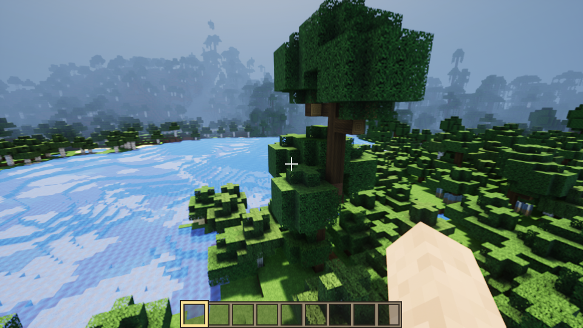

# CraftWorld Unreal

Un jeu de blocs en voxels créé avec Unreal Engine 5.8 : explore un monde immense,
creuse, construis, affronte les créatures de la nuit et descends dans le Nether,
seul ou jusqu'à 8 joueurs.

## Jouer

Il faut Windows 10 ou 11 (64 bits) et une carte graphique compatible DirectX 12.

1. Ouvre la page [Versions](../../releases/latest) et télécharge
   `CraftWorld-Unreal-1.0-Windows.zip`.
2. Décompresse le zip (clic droit → **Extraire tout**).
3. Double-clique sur `Jouer.bat`.

Le premier lancement est plus lent : le jeu prépare ses shaders. Les commandes et
les options sont décrites dans `LISEZ-MOI.txt`, à côté de `Jouer.bat`.

## Jouer à plusieurs

Jusqu'à 8 joueurs. L'hôte ouvre son monde avec **Échap** → **Ouvrir aux autres
joueurs** ; les autres choisissent **Multijoueur** au menu principal et entrent
l'adresse de l'hôte. Sur le même réseau, l'adresse locale suffit. Par Internet,
l'hôte doit ouvrir le port 25565 (TCP) sur sa box, ou tout le monde rejoint le
même réseau privé virtuel (Tailscale, Radmin VPN…). Tous les joueurs doivent
avoir la même version du jeu. Il n'y a pas de mot de passe : ne donne ton adresse
qu'à des personnes de confiance.

## Packs de textures et shaders

Les packs de textures au format Minecraft (zip ou dossier) vont dans
`CraftWorld\resourcepacks`. Le rendu se choisit dans **Options → Shaders** :
Unreal (par défaut), Aucun (rendu classique), ou un pack de réglages JSON du
dossier `CraftWorld\shaderpacks`. Les shaders OptiFine et Iris ne sont pas
compatibles.

## Ce que contient ce dépôt

Seulement cette page. Le jeu prêt à jouer se télécharge dans les
[Versions](../../releases/latest). Son code source n'est pas public.

## Droits

© 2026 — tous droits réservés. Le jeu peut être téléchargé et joué librement ;
il ne peut pas être copié, modifié ni redistribué.

Les images, la police, les sons et la musique ont été créés pour ce jeu. Les
règles, les recettes, la génération du monde et les textes de l'interface
suivent ceux de Minecraft.

CraftWorld Unreal est un jeu indépendant : ce n'est pas un produit officiel de
Mojang Studios ni de Microsoft, et il n'y est pas affilié.

CraftWorld uses the Unreal® Engine. Unreal® is a trademark or registered trademark
of Epic Games, Inc. in the United States of America and elsewhere. Unreal® Engine,
Copyright 1998-2026, Epic Games, Inc. All rights reserved.

Les bibliothèques livrées avec le moteur restent sous leurs propres licences :
voir [LICENCES-TIERS.md](LICENCES-TIERS.md).
